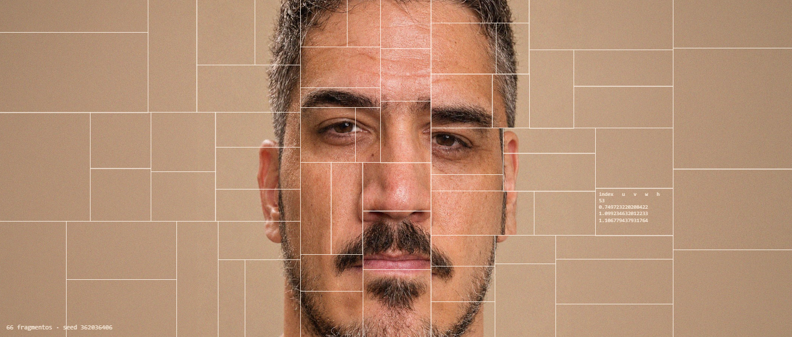

# Danmed UX UI DEV

Portfólio de [@danmed33](https://github.com/danmed33): design, UX/UI e desenvolvimento.

**Site:** https://danmed-dev.lovable.app



## A ideia

Um retrato fatiado em fragmentos que reagem ao mouse, como um patch de TouchDesigner rodando no navegador. A foto é cortada em retângulos (menores no rosto, maiores no fundo) que esticam e se distorcem com mola quando o cursor passa por cima.

Oito desses fragmentos, sorteados a cada carregamento, são portas para projetos. Eles não têm marcação nenhuma: só no mouse over aparecem o nome e o que foi feito, e o clique abre o projeto em outra aba.

## Como navegar

- **Mouse por cima:** os fragmentos distorcem; um deles por vez mostra seus dados (índice, posição e escala).
- **Mouse sobre um projeto:** aparece o nome e o papel no projeto; clique para abrir.
- **Clique em qualquer outro lugar:** gera um novo corte e sorteia outros fragmentos para os projetos.
- **PROJETOS (canto superior direito):** abre uma janela estilo terminal DOS com a lista completa. Setas navegam, Enter abre, Esc fecha.
- **Celular:** 33 fragmentos em vez de 66; o primeiro toque num projeto mostra o nome, o segundo abre.

## Projetos

| Projeto | O que é | Link |
|---|---|---|
| Headhuntr | Vagas diárias com quem abordar | [headhuntr-v1.lovable.app](https://headhuntr-v1.lovable.app/) |
| Riscô | Desenho infantil vira cartaz | [riscoaventura.lovable.app](https://riscoaventura.lovable.app/) |
| Sertãozin | Café com grãos em 3D | [sertaozincafes.netlify.app](https://sertaozincafes.netlify.app/) |
| Solto DSG | Estúdio de design e marca | [soltodsg.netlify.app](https://soltodsg.netlify.app/) |
| Ponte Edu | Oficinas de arte urbana | [ponteedu.netlify.app](https://ponteedu.netlify.app/) |
| Carioca Infocel | Assistência de celular, Vila Isabel | [site](https://steep-snow-732b.bohmarfu33333.workers.dev/) |
| Sob o Sol Expo | Exposição de João Gabriel Salomão | [site](https://withered-sun-e815.bohmarfu33333.workers.dev/) |
| Calor.IA | Calorias da refeição por foto | [caloria-br.lovable.app](https://caloria-br.lovable.app/) |

## Por dentro

Uma página só, sem framework: HTML, CSS e JavaScript puros num único `index.html`, desenhando tudo num `<canvas>`.

- O corte é uma árvore de divisões (treemap) gerada a partir de uma seed aleatória.
- Cada divisão tem física de mola própria, com polaridade e fase diferentes, o que faz os fragmentos se moverem de forma desencontrada.
- Os links (projetos e PROJETOS) são elementos `<a>` e `<button>` reais posicionados sobre o canvas, então funcionam com teclado e leitores de tela.
- Fonte da janela de projetos: [IBM Plex Mono](https://fonts.google.com/specimen/IBM+Plex+Mono).

```
index.html        a página inteira (estilo, estrutura e script)
public/foto.jpg   o retrato
vite.config.ts    Vite servindo o HTML estático
```

## Editar

A lista de projetos fica no começo do script, em `PROJECTS`. Cada item tem:

```js
{ name:'Headhuntr', roles:'produto / ux / dev / ia', desc:'Vagas diárias com quem abordar', url:'https://...', thumb:'thumbs/headhuntr.jpg' }
```

- `roles` aparece no mouse over e na janela PROJETOS.
- `desc` aparece na janela PROJETOS.
- `thumb` é opcional: um print do projeto em `public/thumbs/` substitui o pedaço da foto naquele fragmento.

O projeto está ligado ao [Lovable](https://lovable.dev/projects/3a298256-4468-401e-bf7c-bcda1521b157): o que for enviado para `main` aqui sincroniza lá. Depois de mudar algo, publique de novo no Lovable (Publish → Update).

## Rodar localmente

```sh
npm install
npm run dev
```
